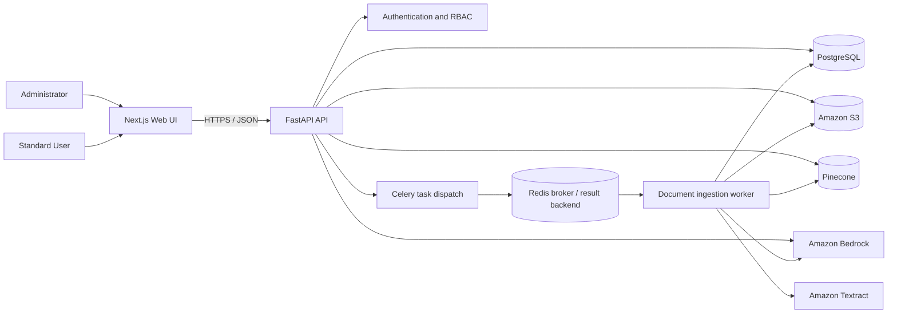
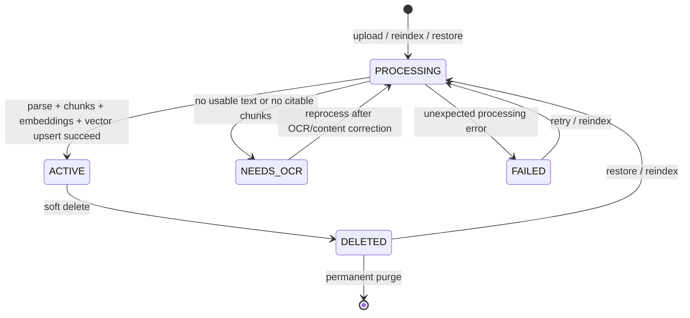
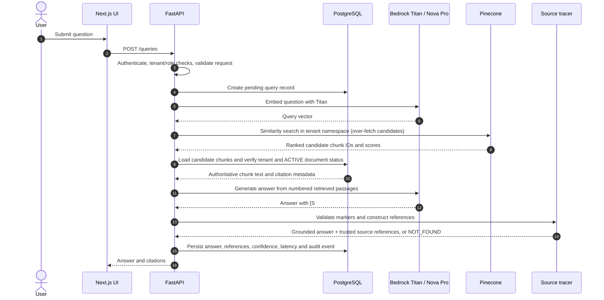

# Nexora AI — High-Level Design (HLD)

> **Document status:** Repository-derived design  
> **Repository:** [rushikesh-pardeshi/End-to-end-Rag-chat-bot](https://github.com/rushikesh-pardeshi/End-to-end-Rag-chat-bot)  
> **Branch inspected:** `main`  
> **Last reviewed:** 2026-11-19  
> **Scope:** Current implementation visible in the repository. Items explicitly labelled *recommended* are not claims about existing code.

## 1. Purpose and scope

Nexora AI is a multi-tenant document question-answering application. Administrators upload business documents; the system extracts and indexes their content. Users ask natural-language questions and receive answers grounded in retrieved passages, with document/page or section citations. The application also provides document management, search history, analytics, user administration, and audit records.

This HLD describes the deployed-code shape at a component and data-flow level. It is not a low-level class/API specification.

## 2. System context

### 2.1 Actors

| Actor | Responsibilities |
|---|---|
| Administrator | Upload, list, preview, restore, reindex, soft-delete and purge documents; view tenant analytics, audit records and users' query history; manage users. |
| Standard user | Ask questions against their tenant's active corpus and view their own query history. |
| Background worker | Process queued document ingestion and reindex/restore work. |
| External services | AWS S3, AWS Textract, AWS Bedrock, Pinecone, PostgreSQL and Redis/Celery infrastructure. |

Tenant membership is resolved from the authenticated user. The tenant is the isolation boundary for relational data and vector retrieval.

### 2.2 Context diagram



## 3. Technology architecture

| Layer | Current implementation |
|---|---|
| Web client | Next.js 16.3, React 19.2, TypeScript, Tailwind CSS 4; Recharts is included for charting. |
| API | FastAPI, Python 3.13, Pydantic request/response schemas. |
| Application structure | Routes → services → repositories → PostgreSQL. |
| Relational store | PostgreSQL 17, SQLAlchemy 2 async, Alembic migrations. |
| Object storage | Amazon S3; server-side encryption configured as AES256; short-lived presigned URLs. |
| OCR | Amazon Textract for scanned PDF pages that do not have a usable text layer. |
| Embeddings | Amazon Bedrock Titan Text Embeddings V2, configured for 1,024 dimensions and normalized vectors. |
| Answer generation | Amazon Bedrock Nova Pro; temperature defaults to 0.0. |
| Vector search | Pinecone; cosine similarity; a separate namespace per tenant. |
| Async ingestion | Celery with Redis broker and result backend. Celery eager mode and an in-process ingestion pool support local/development operation. |
| Tests | Pytest backend tests, including unit, regression and security suites; frontend Jest and TypeScript typecheck scripts. |

## 4. Logical component design

### 4.1 Frontend

The Next.js application provides the browser experience for authentication and the document/query workflows. The repository README identifies login, signup, query, documents, history, audit, analytics and users as application areas.

The browser communicates with FastAPI using the configured API base URL. The backend uses credentialed CORS and cookie-based sessions; unsafe methods require the configured CSRF header/token pair. Route protection in the frontend is a user-experience boundary only: the backend independently enforces authentication, tenant scoping and role authorization.

### 4.2 API and application layers

The FastAPI application factory registers middleware, exception handling, and feature routers. The API is organized into route modules for:

- Authentication
- Documents
- Queries and suggested questions
- Search history
- Analytics
- Audit logs
- Users
- Health checks

The intended dependency direction is:

```text
HTTP route
   ↓
Domain service
   ↓
Repository
   ↓
PostgreSQL
```

Routes validate HTTP input and resolve dependencies. Services implement business rules and orchestrate external systems. Repositories own relational queries. External-system adapters are isolated in dedicated modules (Bedrock, Textract, S3 and Pinecone), making them replaceable in tests.

### 4.3 Core services and adapters

| Component | Responsibility |
|---|---|
| DocumentService | Validate uploads, store original bytes, create document metadata, enqueue ingestion, and manage document lifecycle. |
| Document processor worker | Fetch bytes from S3, parse/OCR, chunk, persist chunk rows, embed, upsert vectors, and activate the document. |
| RagService | Embed a question, retrieve candidate vectors, validate candidates against PostgreSQL, and request a grounded answer from Bedrock. |
| Source tracer | Validate citation markers in model output and construct source references from trusted database chunk records. |
| BedrockClient | Centralized Titan embedding and Nova Pro generation calls, including bounded concurrency/retries and response validation. |
| VectorStore | Centralized Pinecone connection, tenant namespace selection, upsert, similarity search and vector deletion. |
| S3StorageService | Centralized object upload/download, content hashing, presigned URL generation and object deletion. |
| TextractOcrClient | Read scanned PDF pages from their S3 object location and return page-indexed text. |
| AuditService | Append tenant-scoped records for security-sensitive and business actions. |

## 5. Data architecture

### 5.1 Relational entities

| Entity | Purpose / important data |
|---|---|
| Tenant | Organization boundary, tenant name/domain and active flag. |
| User account | User identity, tenant membership, role and authentication-related state. |
| Document | Tenant, sanitized name, immutable S3 key, detected content type, size, hash, version, status, uploader and metadata. |
| DocumentChunk | Tenant/document IDs, chunk order, text, page/section citation, token count and embedding timestamp. The embedding itself is not stored in PostgreSQL. |
| Query | Tenant/user IDs, question, answer, source references, confidence score, status, latency and timestamps. This is also the source for search history. |
| Audit log | Tenant/user/action/object/outcome and request context; append-only audit trail. |

The query table is deliberately reused for search history rather than maintaining a second copy of question/answer data. Source references are stored with the answer so an answer and its citations are persisted together.

### 5.2 Data ownership

- **PostgreSQL is authoritative** for tenant ownership, document status, chunk text, citation locations, query records and audit history.
- **S3 is authoritative** for original uploaded document bytes.
- **Pinecone is a derived retrieval index**. It stores embeddings and limited metadata; it is not the authority for whether a passage may be cited.
- **Redis is infrastructure state** for Celery broker/result handling and configured rate-limiting support; it is not the source of truth for business records.

### 5.3 Tenant isolation

1. Authenticated user resolution supplies the tenant ID to services.
2. Relational repositories scope reads and writes by tenant ID.
3. Pinecone namespace is derived from the tenant ID using the configured namespace prefix.
4. Retrieved vector IDs are loaded back through the query repository with tenant and document-status checks before they can be passed to the model.
5. A cross-tenant object ID should not disclose another tenant's record.

The vector namespace is a first isolation layer, not the only authorization check. PostgreSQL revalidation is mandatory before retrieved content is used.

## 6. Main runtime flows

### 6.1 Document upload and ingestion

```mermaid
sequenceDiagram
    autonumber
    actor A as Administrator
    participant UI as Next.js UI
    participant API as FastAPI
    participant PG as PostgreSQL
    participant S3 as Amazon S3
    participant R as Redis / Celery
    participant W as Ingestion worker
    participant TX as Textract
    participant BR as Bedrock Titan
    participant PC as Pinecone

    A->>UI: Select PDF or DOCX and upload
    UI->>API: POST /documents
    API->>API: Authenticate, authorize, validate file and content type
    API->>S3: Store original bytes under unique document/version key
    API->>PG: Create document row (PROCESSING) and audit upload
    API->>R: Enqueue document ID (production worker mode)
    API-->>UI: 202 Accepted / PROCESSING
    W->>PG: Load document and tenant-scoped metadata
    W->>S3: Download original object
    W->>W: Parse PDF/DOCX text and page/section structure
    opt PDF pages have no text layer
        W->>TX: Start/read OCR job using S3 object location
        TX-->>W: Page-indexed LINE text
    end
    W->>W: Split into overlapping chunks with citation metadata
    W->>PG: Persist chunk rows
    W->>BR: Generate Titan embeddings
    BR-->>W: 1,024-dimensional vectors
    W->>PC: Upsert vectors into tenant namespace
    W->>PG: Mark chunks embedded; set document ACTIVE; audit result
```

Implementation notes:

1. The upload request validates the file and stores the original bytes in S3. The document row begins in `PROCESSING`; the API returns without waiting for the full embedding pipeline when using the asynchronous worker path.
2. The worker receives identifiers, not the document bytes. It retrieves the original bytes from S3, avoiding copies of customer content in the task broker.
3. PDF and DOCX parsing is handled by the document parser. For PDFs with pages lacking a text layer, the ingestion path can invoke Textract against the S3 object.
4. Sections/pages are split into chunks. Defaults in configuration are 512 tokens per chunk and 64 tokens overlap (the splitter uses an approximate character conversion).
5. Titan embeddings are generated and vectors are upserted in batches to the tenant's Pinecone namespace.
6. The document becomes `ACTIVE` only after vector upsert and chunk embedding bookkeeping succeed. A document that has no extractable text can end in `NEEDS_OCR`; processing exceptions are recorded as `FAILED`.

Document lifecycle:



Soft delete is reversible and does not immediately erase the S3 object or chunk rows. The document status makes it ineligible for retrieval. Restore/reindex rebuilds derived chunks and vectors from the S3 original. Permanent purge is a separate administrator-only operation.

### 6.2 Question answering (RAG)



Key retrieval and grounding rules observed in code:

- The question is embedded with Titan. For follow-up questions, the prior question can be combined with the new question to give the retriever context; the prior generated answer is not used as retrieval text.
- Pinecone is queried only within the current tenant namespace. The service over-fetches candidates using the configured multiplier to allow invalid/stale candidates to be discarded.
- Candidate IDs are reloaded from PostgreSQL. Only chunks belonging to the current tenant and an `ACTIVE` document are eligible to reach the prompt.
- The model receives numbered passages. The source tracer validates that the answer contains valid markers referring to supplied passages.
- An answer with no valid citation is replaced with the fixed not-found response when citation enforcement is enabled. Invented/out-of-range markers are not accepted as sources.
- Source names, pages/sections and excerpts in the response are reconstructed from PostgreSQL chunk/document records, not trusted from model-authored citation text.
- Retrieval similarity is recorded as a confidence signal; it is not a calibrated probability that the answer is factually correct.

### 6.3 Search history, analytics and audit

- Query rows retain the question, answer, source references, status, confidence and latency.
- Standard users see their own history; administrators can see tenant-wide history and analytics.
- Audit events record the actor, tenant, action, object type/ID, outcome and request context. The code treats the audit log as append-only and serializes tenant audit-chain writes.
- Logs are structured and include request correlation IDs. Sensitive document contents and credentials should not be written to logs.

## 7. API and access-control boundaries

The FastAPI route modules expose the feature surface. The exact request/response schemas are defined in the Pydantic schema modules.

Security controls visible in the implementation include:

- Cookie-based authentication with backend identity/role resolution.
- Tenant scoping in repositories and service methods.
- Role-based checks for administrator-only operations.
- CSRF verification for unsafe HTTP methods, with narrowly scoped auth exemptions.
- Credentialed CORS using an explicit origin allowlist.
- Rate limiting middleware and route limits.
- Request IDs, structured logging and security response headers.
- Generic client-facing internal-error responses rather than returning raw exception details.
- Upload size/content validation and sanitized storage names.
- JSON-only Celery task serialization; task payloads use IDs/strings rather than uploaded document bytes.

Frontend route guards are not an authorization substitute. Every sensitive operation must remain protected by backend dependencies and service-level checks.

## 8. Deployment view

The repository contains separate backend and frontend Dockerfiles. The backend is started from the root entry point and serves port 8000 in the documented local/Docker workflow. The Next.js application runs on port 3000. PostgreSQL and Redis are external dependencies; the application containers do not embed PostgreSQL.

A production deployment therefore needs these independently managed runtime units:

1. Next.js web service.
2. FastAPI API service.
3. Celery worker process(es) using the same backend application package/configuration.
4. PostgreSQL database.
5. Redis broker/result backend (and configured rate-limit storage, as applicable).
6. AWS S3 bucket, Bedrock model access and Textract access.
7. Pinecone index configured to match the Titan embedding dimension and similarity metric.

The code supports a local eager/in-process ingestion mode. For durable asynchronous production processing, run Celery with a reachable broker and worker rather than relying on eager execution or an in-process task pool.

## 9. Reliability, consistency and failure handling

| Failure / condition | Expected handling in the current design |
|---|---|
| S3 upload fails | Upload does not proceed as a successfully stored document. |
| No text extracted | Document is marked `NEEDS_OCR`; it is not searchable as active content. |
| Bedrock/Textract/Pinecone transient failure | Retries/timeouts are bounded in adapters/configuration; ingestion is marked failed where the pipeline cannot complete. |
| Worker is interrupted | Late task acknowledgement permits redelivery; chunk/vector IDs make reprocessing idempotent in important write paths. |
| Pinecone returns stale/deleted chunk | PostgreSQL revalidation discards it before prompting. |
| Soft delete while vectors remain | PostgreSQL status check prevents citation; vector deletion is cleanup, not the authorization boundary. |
| Model answer has no valid citation | Source tracer returns the fixed not-found answer rather than publishing ungrounded prose. |
| API unexpected exception | Generic 500 envelope, request correlation/logging and security headers. |

## 10. Scalability considerations

Existing design choices that help scaling:

- API and background ingestion are separate execution paths.
- Bedrock embedding calls use bounded concurrency; Pinecone upserts/deletes are batched.
- Database connection pooling is configured centrally.
- Celery worker concurrency can be scaled independently from API replicas.
- Tenant namespaces avoid mixing vector-search spaces.
- Relational indexes support tenant/status document lists and tenant/user query history.
- Query latency is persisted for operational measurement.

Capacity planning still requires load tests against the actual AWS account, Bedrock model quotas, Pinecone plan/index limits, Redis, PostgreSQL pool limits, file-size/page limits and worker concurrency. Do not infer a supported request-per-second or one-million-user capacity from the architecture alone.

## 11. Security and privacy considerations

- Keep AWS, Pinecone, database and signing credentials in environment/secret management; never ship them to the browser or commit real values.
- Use TLS between browser/API and for all external service connections.
- Keep S3 private; use short-lived presigned URLs only when required.
- Enforce tenant ID and role on every API operation and every repository read/write.
- Preserve the Pinecone namespace plus PostgreSQL revalidation pattern for retrieval.
- Keep audit records append-only; avoid logging filenames, extracted passages, question/answer content or secrets unless a specific approved retention design requires it.
- Restrict Redis and Celery broker access to trusted application/worker networks.
- Apply least-privilege IAM to S3, Bedrock and Textract.
- Define backup, retention, deletion and disaster-recovery policies for PostgreSQL, S3, audit records and vector indexes.

## 12. Known repository/documentation alignment items

These are documentation/operational observations, not assumptions about runtime defects:

1. The root README's project tree describes lowercase `backend/` and `frontend/`, while the current repository tree contains `Backend/` and `Frontend/`. Use the actual case-sensitive paths when navigating/building on Linux.
2. The root README links to `docs/RUNNING.md`, but no root `docs/` directory was present in the inspected `main` tree at the time of writing. This HLD creates that directory.
3. The README describes the architecture and feature surface; implementation details in this document were cross-checked against the current API, service, repository/model, vector-store and worker modules. If implementation and README differ, the code is the source of truth.
4. Local development can run Celery eagerly or use the in-process ingestion pool. This should not be confused with a durable distributed worker deployment.

## 13. Future design recommendations (not asserted as implemented)

- Add distributed tracing across API → queue → worker → AWS/Pinecone calls, propagating a trace ID through task metadata.
- Define queue depth, ingestion age, failed-document, Bedrock throttling, Pinecone latency, database pool saturation and end-to-end query latency SLO dashboards/alerts.
- Establish explicit retry/backoff and dead-letter/reconciliation procedures for jobs that exhaust retries.
- Add a repeatable backup/restore and vector-index rebuild runbook; the original S3 object and PostgreSQL metadata should be sufficient to reconstruct derived embeddings.
- Run tenant-isolation, prompt-injection, citation-grounding, OCR-quality and load tests as release gates.
- Version embedding model, dimension, chunking configuration and prompt strategy in index metadata or deployment configuration so reindex migrations are controlled.

## 14. Source files reviewed

Representative implementation sources used to prepare this HLD:

- `README.md`, `main.py`, root `Dockerfile`
- `Backend/api/app.py`, `Backend/api/routes/{auth,documents,queries,analytics,audit_logs,search_history,users}.py`
- `Backend/api/dependencies/{auth,database,services}.py`
- `Backend/core/{config,database,security,limiter,logging}.py`
- `Backend/models/{tenant,user,document,query,audit_log}.py`
- `Backend/repositories/*.py`
- `Backend/services/{document_service,rag_service,query_service,source_tracer,bedrock_client,textract_client,storage_service,audit_service}.py`
- `Backend/utils/{document_parser,chunk_splitter,vector_store}.py`
- `Backend/workers/{celery_app,document_processor}.py`
- `Frontend/package.json`, `Frontend/proxy.ts`, `Frontend/Dockerfile`

---
**End of document**
